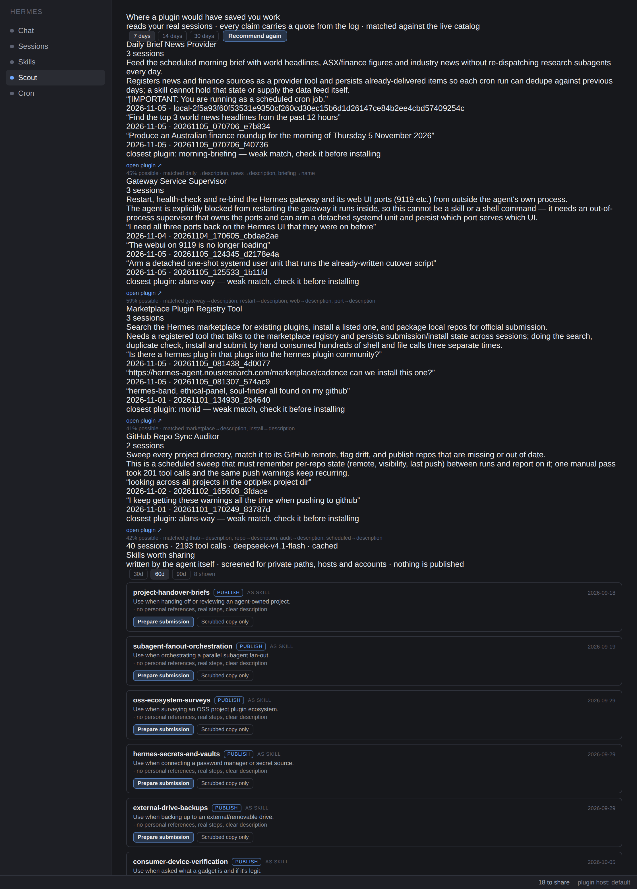

# Lazy Plugin

**A page in Hermes Desktop where you describe a plugin and watch it get built — then proves it runs
before you install anything.**



## What it is

A Hermes plugin that builds Hermes plugins — on the desktop page, from a chat turn, or as
`lazyplugin_create` inside any conversation. What makes it different from a scaffolder is what
happens *after* the files are written: the new plugin is loaded, its tools are called for real, and
the result is graded. A plugin that validates but cannot run shows up as broken, on screen, before
you install it.

## Where a build starts

| Start from | Why it works |
|---|---|
| **a sentence** | you know the job; it becomes tools |
| **a skill the agent wrote** | the procedure is already written — turn it into something that runs without the model |
| **a job that runs on a schedule** | recurring work with a history — make it a tool call instead of a turn |

## The loop

```
page ──▶ a real chat turn, in the chat pane (you watch it happen)
          └─▶ spec in words: name, 1–3 tools, what each reads/fetches, what it returns
              └─▶ lazyplugin_create ─▶ fixed templates write the code
                  └─▶ hermes plugins validate ─▶ the exact ✗ line if it fails
                      └─▶ every tool dispatched once ─▶ works · needs a key · blocked upstream · half-built · broken
                          └─▶ the page shows the receipt, then you decide about installing
```

**The model writes the spec. Templates write the code.** Model-authored Python is how you get
plausible garbage that dies on import; model-authored *intent* rendered through fixed templates
always registers, declares exactly the capabilities it provides, and cannot carry injected code.

Handler bodies are limited to four shapes:

- `command` — runs a binary from `config.argv` (list argv, never a shell string)
- `http` — GET/POST a URL, with a declared `url` parameter winning over the baked default
- `file` — read/write a path from `config.path` or a declared `path` argument
- `stub` — raises `NotImplementedError` carrying the described behaviour

A spec that cannot work is refused **before any file is written**: name shape, description length,
unique snake_case tool names, and a real target — an http tool needs an absolute URL, a command tool
needs argv, a file tool needs a path or a declared `path` parameter.

## The part a skill cannot do

A skill can describe a plugin. It cannot execute one inside the host and hand back a verdict.

Every build ends with a dispatch: the new tool is called through the real registry, exactly as the
model would call it, and graded.

| Verdict | Means |
|---|---|
| `purrs` | the tool was called and returned real results |
| `needs a key` | sound package, wants an environment variable you have not set |
| `blocked upstream` | our side works; the far end answered 403/404 |
| `half-built` | the handler was never written — the spec fell to a stub |
| `broken` | it would not load, or the handler raised |

The receipt is a straight line — `plan · files · check · try-out` — and every row is either a tick
or the exact failing line. No green badge without the line underneath it.

## Never installs by itself

Generated plugins land in `$HERMES_HOME/lazy-plugin/created/<name>/` as files you can read. Nothing is
linked into `~/.hermes/plugins` until you ask:

```bash
hermes plugins validate $HERMES_HOME/lazy-plugin/created/<name>
ln -s $HERMES_HOME/lazy-plugin/created/<name> ~/.hermes/plugins/<name>
hermes plugins enable <name>
```

**Install** re-runs the validator first and refuses to clobber an existing plugin. A generated plugin
that fails its try-out is refused too — a scaffold you can install is a trap.

## Publishing

There is no upload endpoint and no self-serve registry: the catalog is a **human-merged gate**. A PR
adds `plugin-catalog/<name>.yaml` to `NousResearch/hermes-agent` pinning a full 40-character commit
SHA of a public repo.

**Publish** does the mechanical half with your own `gh` login — validate, commit, create the public
repo, pin the SHA, write the entry from the real manifest, then offer the catalog PR. A maintainer
still decides; nothing here merges anything.

## Using it from chat

`lazyplugin_create` is an ordinary tool, so it runs inside a turn and the host resolves whatever model
and credential that profile has — API key, OAuth proxy, cloud or local. The plugin holds no key, names
no provider, and shells out to nothing. Install it on any profile and the agent already knows how to
build plugins.

## Tools

| Tool | Does |
|---|---|
| `lazyplugin_create` | build from `idea`, or from `source_kind` + `source_name` |
| `lazyplugin_sources` | list the agent's own skills and scheduled jobs |
| `lazyplugin_built` | list what has been generated, with paths |

## Tests

```bash
python3 -m venv .venv && .venv/bin/pip install pytest fastapi httpx
.venv/bin/python -m pytest tests -q          # 133 passed
hermes plugins validate .                    # every catalog gate
```

## Limits, honestly

- Three handler shapes cover most small tools. Anything needing real state, retries or pagination
  wants a hand-written plugin, and the spec validator will refuse shapes it cannot render safely.
- The try-out uses sample arguments (`date` → today, `domain` → example.com). A tool that needs a
  specific id will come back broken even if the code is fine — the receipt says why.
- Builds are agent turns, so they cost tokens and they take as long as your model thinks.

MIT.
